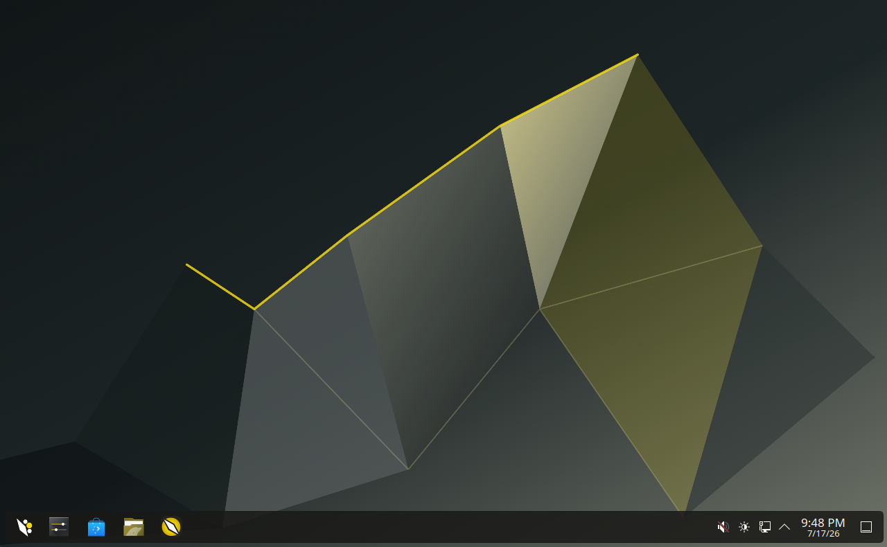
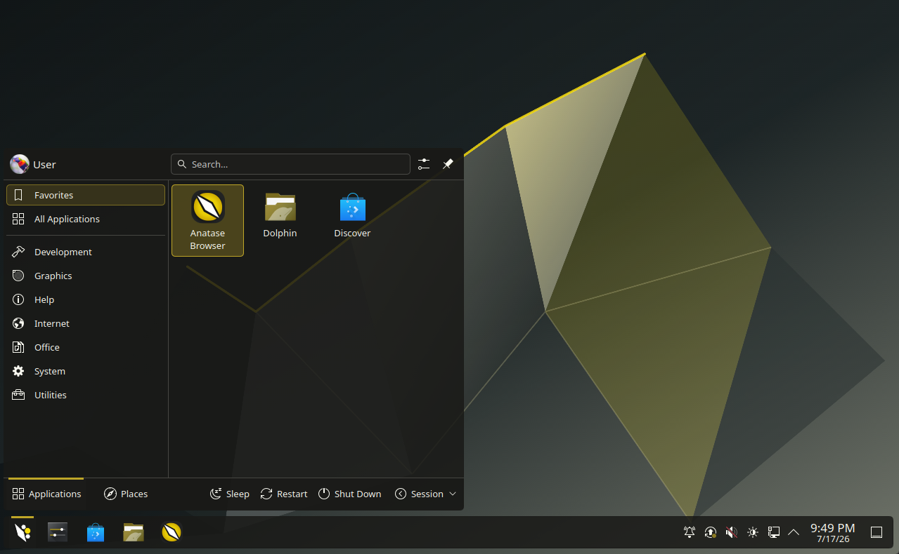
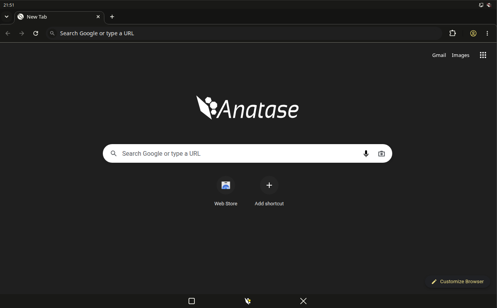
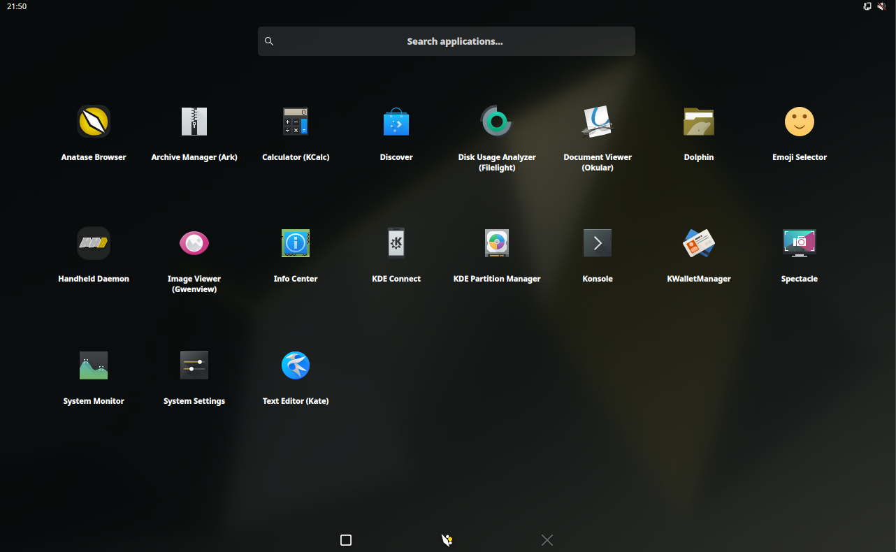
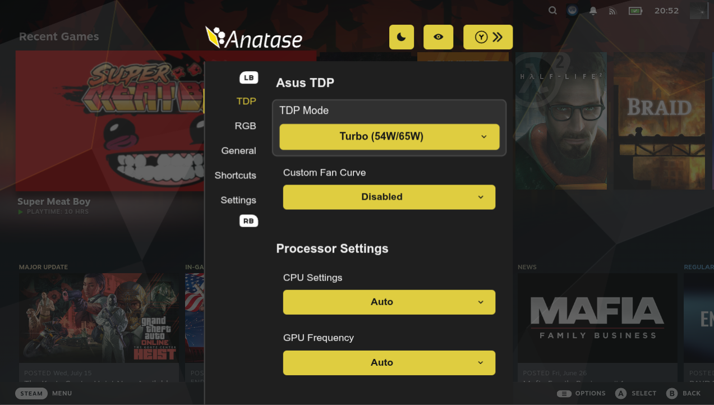

  <picture>
    <source
      media="(prefers-color-scheme: dark)"
      srcset="cards/base/identity/letterhead-onblack.svg">
    <source
      media="(prefers-color-scheme: light)"
      srcset="cards/base/identity/letterhead-onwhite.svg">
    
  </picture>

# Anatase

Anatase is an immutable Linux distribution based on Fedora that uses bootc, which means that it is a container. It can be used as an alternative to SteamOS or as a general desktop distribution for gaming, development, and general work.

Not sure if Anatase is right for you? Check how it stacks up against [other desktop distributions](https://docs.anatase.org/linux-distributions) or [SteamOS alternatives](https://docs.anatase.org/steamos-alternatives).

Ready to take the dive? Follow the [installation guide](https://docs.anatase.org/basics/install) or browse the [website](https://anatase.org/).

### Plasma Desktop
Anatase uses KDE Plasma as for its desktop. It is performant, _feels_ like Windows, and is progressing rapidly with a core team of competent developers. Anatase preinstalls Ark (Archive Manager), Filelight (Disk Usage Analyzer), Kate (Text Editor), and Okular (Document Viewer), which come from KDE, so you can do basic tasks out of the box.

### Plasma Mobile
Anatase also offers Plasma Mobile for tablet-like devices, such as handhelds and two-in-ones (Asus Z13). While Plasma Mobile is still in its early days, it already feels great to use, and for its 20MB install size, it delivers a punch and is great for use in e.g., flights.

Also shown, the Anatase Browser. A Chromium based browser with **working GPU acceleration**, **support for Spotify & 720p Netflix**, and **a built-in adblocker** that works great and updates with the system**. _Yes, having working GPU acceleration is a big deal in Linux._

**Adblocker is based on UBOLite, a completely offline adblocker, and can be rebuilt on demand if the filter lists become outdated without delays from Chrome Store approval and delivered as a signed Flatpak.

### Gamemode
Anatase also has a Gamemode that brings in elements from SteamOS as an optional addon. Compared to gaming in Plasma Desktop:

 * Gamemode is intuitive to touch
 * It uses less RAM than a Desktop session
 * Brings the game closer to the GPU, with advanced controls for VRR, Framerate, and HDR. 
 * New in Anatase: **Frame Generation (2X)**. After enabled, games are rendered at half of your target FPS and the other half is generated. Works in all games and with all anticheat!
 * Compared to SteamOS and Bazzite, it gets out of your way. There are proper lock and login screens so you can use this for your desktop or have multiple users, while also being able to set it to autolaunch on boot.

## Roadmap
 * Achieve SLSA3
   * Port github attestations and use them verify CI images end-to-end
   * Add SBOM support using a custom metadata format to record transient changes (new fedora packages, git+ repo pulls)
 * Build an arm image
   * Begin with one handheld: Pocket Retroid 6, as it supports UEFI compatible booting from SD card without invasive changes
   * Expand device coverage
 * Expand kernel to support TPM attestation for hibernation and initramfs verification
   * Hibernation is currently forcibly disabled when secure boot is enabled to comply with secure boot requirements
   * Use a TPM Policy from the current kernel to HMAC verify the hibernation image and block kernel takeovers
   * The initramfs is not currently verified. Automatic unlock of encrypted hard disks through the TPM can be bypassed
   * Sign the initramfs with an attached signature. Make the kernel extend an unused PCR depending on initramfs status, use that PCR as part of unlock policy and re-extend the PCR when exiting the initramfs
 * In the future, apply for Secureboot

## Contributing

Anatase does not currently accept external contributions. You are welcome to post issues in the issue tracker, with suggestions or bug reports.

## License

A copy of the files in this repository is provided to you under the terms of [GNU Affero General Public License v3.0 or later](LICENSE). Exceptions: `.patch` files carry the license of their respective project solely and files with an SDPX license header carry that license solely.

You may reuse the Anatase mark when producing derived images or rehosting unmodified images that are for personal or internal organizational use. Otherwise, [fork](https://github.com/anatase-org/anatase/fork) Anatase and replace the identity card with your type and marks.

Anatase is not currently at the stage where it can be pre-installed on devices.

**Non-legally binding TLDR:** Anatase is free software and under the terms of AGPLv3, you may freely adapt the software for your or your organization's (internal) needs without publishing your changes. The same applies to the mark. An example of internal use is your IT department installing Anatase on your laptop or you putting it on your son's laptop. 

You are also encouraged to and allowed to freely share Anatase remixes created based on [its template](https://github.com/anatase-org/template) and base image in Discord, Github, Reddit, and other social media. We are all here to have fun. Get creative.
